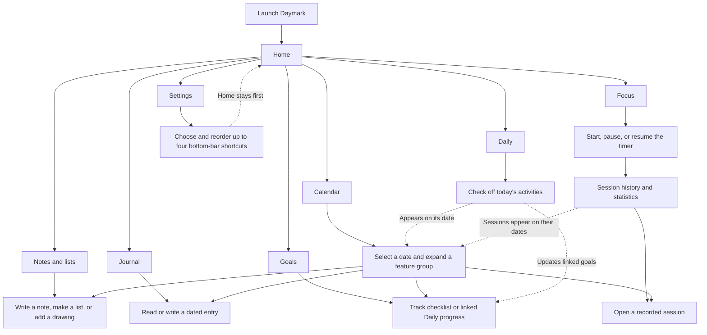

# Daymark

Daymark is an Android-first personal organizer built with Flutter and Dart.

## App flow



Home cards open every feature. The default bottom bar shows Home, Notes,
Calendar, Daily, and Journal. Goals and Focus can also be pinned from
**Settings → Navigation**.

## Stack and architecture

- Flutter and Dart, optimized for Android-first use.
- Official Material widgets are provided by the `material_ui` package.
- MVVM with `Provider` and `ChangeNotifier`.
- Views handle presentation and interaction; ViewModels handle presentation
  state and actions.
- Repositories isolate local persistence from the domain and UI.
- Drift over SQLite provides durable, offline-first local storage.
- Business rules remain independent of Flutter widgets and remote services.

Firebase, Firestore, authentication, synchronization, and remote databases are
explicitly outside the approved scope at this stage.

## Current functionality

Daymark provides local sticky notes, Daily recurring activities, a private
Personal Journal, and a Calendar for browsing dated notes and journal entries.

### Sticky Notes

- Use plain text, a checklist with saved check marks, or a numbered list.

- Create notes containing at least one non-whitespace character.
- Optionally add a title and subtitle; every note records its localized creation date.
- View saved notes and an explicit empty state.
- Open a separate note editor from the notes list instead of mixing creation
  controls with browsing.
- Filter notes by text across title, subtitle, and content, or by a creation-date range.
- Date filtering is limited to today and earlier.
- Notes with drawings show a localized drawing icon instead of a drawing preview.
- Create or edit a freehand drawing in a separate dialog. Saving the drawing shows
  a preview in the note editor, and saving the note persists drawing changes locally.
- Home always provides access to Notes, Calendar, Daily, Journal, and Goals.
  Use Settings → Navigation to choose and reorder up to four bottom-bar
  shortcuts. Settings and icon help are available in each feature's top bar.
- Use Home as the feature launcher with a responsive two-column grid.
- Change the application language between Spanish and English from Settings.
- Store Spanish and English interface strings in local JSON assets.
- Choose one of three appearance styles (Soft, Playful, or Minimal).
- Choose one of six color palettes (Vanilla, Sage, Rose, Sky, Lavender, or Peach).
- Apply appearance changes immediately across the application.
- Restore appearance preferences after restarting the app while offline.
- Show a branded Flutter loading screen during startup and use the Daymark symbol
  for the in-app loading composition; the Android launcher uses the separate icon
  asset and adaptive background resources.
- Keep notes available after closing and reopening the app.
- Create and view notes without an Internet connection.
- Show validation and persistence error feedback without reporting false success.

### Daily activities

- Create, edit, and delete recurring activities stored locally with Drift/SQLite.
- Choose `Anytime` or a specific local wall-clock time.
- Select and persist an activity icon from the built-in Daily icon catalog.
- Mark activities complete or incomplete for the current local calendar date.
- Preserve completion history across dates without duplicating recurring activities.
- Enable optional local notifications for specific-time activities.
- Request notification permission only when the user enables reminders; notification
  failures do not block local activity CRUD or completion tracking.
- Use responsive activity cards and a scrollable, localized create/edit dialog with
  icon selection, schedule controls, reminder settings, and delete confirmation.
- Support Daily UI strings in Spanish and English across the existing theme styles and
  color palettes.

Daily remains offline-first. Authentication, Firebase, Firestore, remote databases,
cloud synchronization, weekly/custom recurrence, snoozing, and remote notifications
are not part of the current scope. Operating-system alarm restrictions may delay or
prevent local notifications; Android build and emulator verification is performed by
the implementation owner.

### Personal Journal

- Open Journal from the Home launcher or bottom navigation.
- Browse entries in reverse chronological order with localized month grouping.
- Keep multiple entries on the same date.
- Create entries with optional titles, text, dates, and drawings.
- Create and edit drawings in a separate dialog using the shared `core/drawing`
  canvas and serialization. Saving the drawing shows a preview in the entry editor.
- Show a localized drawing icon in the journal index instead of a drawing preview;
  the complete drawing remains available in the reading view.
- Read entries in a dedicated view and edit them without losing the updated
  content when returning to reading mode.
- Remove drawings explicitly while editing an entry.
- Delete entries after confirmation; associated drawing data is removed locally.
- Protect unsaved editor changes with a discard confirmation.
- Show localized loading, validation, save, load, and delete feedback.
- Persist journal entries and drawings in the local Drift/SQLite database.
- Support English and Spanish and the existing appearance styles and palettes.

Personal Journal remains entirely offline. Cloud synchronization, accounts,
sharing, exporting, rich text, audio, and AI assistance are outside the current
scope. The complete feature specification is documented in
[specs/005-personal-journal/spec.md](specs/005-personal-journal/spec.md).

### Calendar

- Browse months or switch to a twelve-month overview. Use Today to return to the
  current date.
- Filter monthly and annual indicators by type. Each day groups dated notes,
  Journal entries, goal deadlines, completed Daily activities, and Focus sessions.
- Create notes for any supported day and change or remove their optional dates.
- Notes created from Notes and lists default to today. Open Undated notes in
  Calendar to find notes without a calendar date.
- Write Journal entries for today or earlier and open existing content directly
  from Calendar.
- Existing notes remain available in Sticky Notes. Their creation timestamps
  are preserved separately from their optional Calendar dates.

See the [Calendar specification](specs/007-calendar/spec.md).

### Goals

- Create personal goals by checklist or by number of Daily completions. Filter
  the list by status and check off personal steps from the list or detail screen.
- Set an optional deadline. Calendar shows dated goals and opens their details.
  An overdue goal remains active until its progress reaches 100%.
- From the goal editor, link one existing Daily activity for a counter, or
  several Daily activities as separate checklist items. Each checked day adds
  one to the counter or marks the corresponding checklist item. Unchecking
  removes that day's contribution.
- Goals and navigation preferences are stored locally.

See the [Goals and customizable navigation specification](specs/008-goals/spec.md).

### Focus

- Run a concentration timer with configurable short and long breaks. Defaults
  are 25, 5, and 15 minutes, with a long break after four focus sessions.
- Pause, resume, reset, or stop a session. The timer keeps its end time across
  navigation and app restarts, and history records active time without pauses.
- Associate sessions with custom activities or activities added from Daily.
- Use the single Break mode. Focus chooses the short or long duration based
  on the current cycle.
- Browse recorded sessions in Calendar or open Focus history for totals and
  activity breakdowns. Focus is available in Home and navigation settings.
- Android completion notifications are subject to permission and device
  scheduling. The timer still works if notifications are unavailable.

See the [Focus specification](specs/009-focus/spec.md).

## Localization and settings

The current language selector is intentionally limited to Spanish and English.
Translations live in [assets/i18n/es.json](assets/i18n/es.json) and
[assets/i18n/en.json](assets/i18n/en.json), and are loaded locally through
`AppLocalizations`. Flutter's Material, Widgets, and Cupertino localization
delegates are also configured so date pickers and platform controls follow the
selected locale.

The selected language currently applies for the active application session. A
future approved feature may persist this preference locally; no remote service is
used for language selection.

## Appearance customization

Feature 002 centralizes visual customization under [lib/core/theme/](lib/core/theme/):

- `app_styles.dart` defines the three component-treatment styles.
- `theme_presets.dart` defines the six semantic color palettes.
- `app_theme.dart` composes any style/palette combination into `ThemeData`.

Appearance preferences are managed by `ThemeViewModel` and stored in a separate
Drift `AppPreferences` table. The existing `Notes` table and note serialization
are unchanged. Preferences load before the main shell is rendered, so the app
does not show the default theme while saved values are being restored. Missing
or invalid values fall back to Soft + Vanilla.

Settings provides one compact UI Style dropdown, a localized description of the
selected style, selected-state indicators, a reset action, and responsive palette
swatches. Typography is centralized in the style
tokens: Soft uses warm serif headings, Playful uses the Android generic `cursive`
family with a sans-serif fallback, and Minimal uses a neutral sans-serif
hierarchy. No font dependency or unverified font asset is included; Comic Sans MS
is not assumed to be installed on Android.

Home feature cards use compact natural content flow: the icon and navigation
affordance share the top row, titles and descriptions follow without an expanding
spacer, and each icon has a subtle theme-derived rounded background.

## Development checks

Run these commands before submitting changes:

```text
dart run build_runner build
dart format lib test
flutter analyze
flutter test
```

Android tooling is configured with Android Gradle Plugin 9.3.1, Kotlin 2.4.20,
and Gradle 9.5.0, which meet the current Flutter compatibility minimums.
Android debug builds and emulator verification are run by the implementation
owner.


## SDD and TDD workflow

Feature work follows the approved Spec-Driven Development flow:

1. Define the feature in `specs/<feature>/spec.md`.
2. Create the technical plan and requirement mapping in `plan.md`.
3. Generate executable tasks in `tasks.md`.
4. Implement only the approved scope.
5. Validate requirements, tests, analysis, formatting, and documentation.

Feature specifications and implementation artifacts are tracked under
[`specs/`](specs/), including the implemented Daily feature in
[`specs/004-daily/`](specs/004-daily/) and the implemented Personal Journal in
[`specs/005-personal-journal/`](specs/005-personal-journal/).

Implementation follows TDD: **Red -> Green -> Refactor**. A regression or new
behavior should have an automated test before its implementation, and test
results are reported only after the command has actually been executed.
